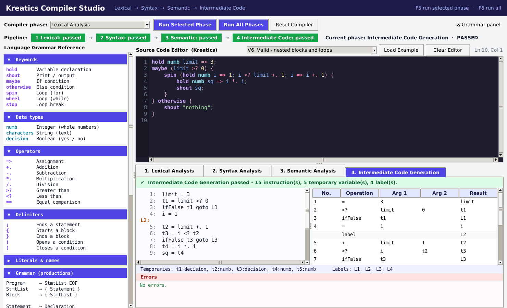
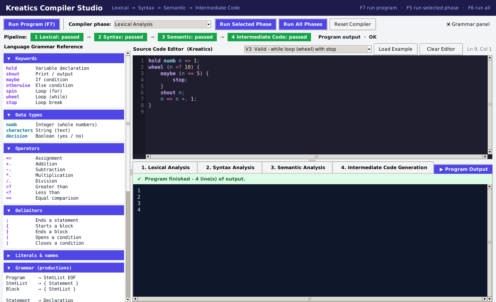
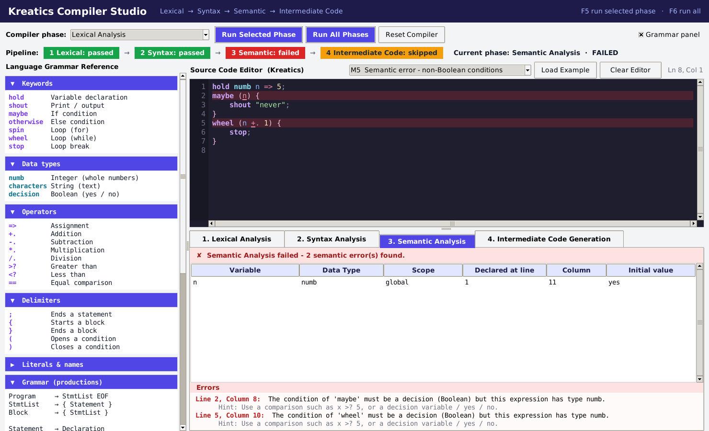

# Kreatics Compiler Studio

A working compiler for **Kreatics**, a small custom programming language, written in Python with an interactive Tkinter GUI. It was built as a Compiler Construction course project (BSCS III-B).

You type a Kreatics program, pick one compiler phase from a dropdown, and see the real output of that phase: a token table, a syntax tree, a symbol table, or three-address code. Nothing on screen is hard-coded; every output comes from the compiler logic.



## Features

- **Run Program:** one click (`F7`) compiles your code and shows what the program prints in the **Program Output** tab, without opening any phase tab. Compile errors and runtime errors (such as division by zero or an endless loop) are explained clearly.
- **Four independent phases:** Lexical Analysis, Syntax Analysis, Semantic Analysis and Intermediate Code Generation (three-address code).
- **Phase rules enforced:** a phase never runs if an earlier phase failed. Running a later phase automatically runs the earlier ones first. Editing the code clears old results.
- **Clear errors** with line and column, a hint on how to fix them, and the bad line marked in red inside the editor.
- **Custom editor** with line numbers and syntax highlighting for Kreatics only (it uses the project's own lexer, not another language's rules).
- **Grammar reference panel** with collapsible sections, always visible while you code.
- **20 demo programs** (6 valid, 14 with one deliberate error each) loadable from a dropdown.
- **No dependencies:** Python standard library only.
- **Modular design:** compiler logic is fully separate from the GUI.





## The Kreatics language

| Purpose | Keyword | | Purpose | Operator |
|---|---|---|---|---|
| Variable declaration | `hold` | | Assignment | `=>` |
| Print / output | `shout` | | Add, subtract, multiply, divide | `+.` `-.` `*.` `/.` |
| If / else | `maybe` / `otherwise` | | Greater than / less than | `>?` / `<?` |
| Loop (for) / (while) | `spin` / `wheel` | | Equal comparison | `==` |
| Loop break | `stop` | | | |

**Types:** `numb` (integer), `characters` (string), `decision` (Boolean, literals `yes` / `no`).

```
hold numb total => 0;
spin (hold numb i => 1; i <? 6; i => i +. 1) {
    total => total +. i;
}
maybe (total >? 10) {
    shout "big";
} otherwise {
    shout "small";
}
```

### Grammar

```
Program     → StmtList EOF
StmtList    → { Statement }
Block       → { StmtList }
Statement   → Declaration | Assignment | Conditional | WhileLoop
            | ForLoop | Output | Break
Declaration → hold Type ID [ => Expr ] ;
Assignment  → ID => Expr ;
Conditional → maybe ( Expr ) Block [ otherwise Block ]
WhileLoop   → wheel ( Expr ) Block
ForLoop     → spin ( ForInit ; Expr ; ForStep ) Block
ForInit     → hold Type ID => Expr | ID => Expr
ForStep     → ID => Expr
Output      → shout Expr ;
Break       → stop ;
Type        → numb | characters | decision
Expr        → RelExpr
RelExpr     → AddExpr { ( >? | <? | == ) AddExpr }
AddExpr     → Term { ( +. | -. ) Term }
Term        → Factor { ( *. | /. ) Factor }
Factor      → INTEGER | STRING | yes | no | ID | ( Expr )
```

### Semantic rules

- Declare a variable before using it; no duplicate declarations.
- Assigned and initial values must match the variable type.
- `+. -. *. /. >? <?` need `numb` operands; `==` needs both sides of the same type.
- Conditions of `maybe`, `wheel` and `spin` must be `decision`.
- `stop` is only allowed inside `wheel` or `spin`.
- `/.` is integer division; dividing by the literal `0` is an error.

## Compiler phases

| Phase | What it does | Output |
|---|---|---|
| 1. Lexical Analysis | Reads the source character by character and creates tokens; reports invalid characters | Token table (number, lexeme, type, line, column) |
| 2. Syntax Analysis | Recursive-descent parser checks the grammar | Validation status and Abstract Syntax Tree |
| 3. Semantic Analysis | Scoped symbol table and type checks | Symbol table and semantic errors |
| 4. Intermediate Code | Generates three-address code from the validated AST | Numbered TAC, temporaries, labels, quadruple table |

Example output for `hold numb x => 2 +. 3 *. 4;`

```
   1:   t1 = 3 *. 4
   2:   t2 = 2 +. t1
   3:   x = t2
   4:   print x
```

## Getting started

**Requirements:** Python 3.8 or newer. Tkinter comes with the Windows and macOS installers; on Linux run `sudo apt install python3-tk`.

```bash
git clone https://github.com/<your-username>/<repo-name>.git
cd <repo-name>
python main.py
```

### Using the app

1. Choose an example from the dropdown above the editor and press **Load Example**, or press **Clear Editor** and type your own code.
2. To see only the program's output, press **Run Program** (`F7`) and read the **Program Output** tab.
3. To study the compiler, pick a phase in the **Compiler phase** dropdown and press **Run Selected Phase** (`F5`), or press **Run All Phases** (`F6`).
4. Open each phase's tab to see its output. The pipeline bar at the top shows passed, failed and skipped phases.
5. **Reset Compiler** clears the results but keeps your code.

### Command line

```bash
python cli.py program.kr 4      # run a file up to phase 4 (1 = lexical ... 4 = intermediate code)
```

### Tests

```bash
python -m unittest discover -s tests -v
```

There are 33 tests. Every demo program must pass or fail at the correct phase, and the generated three-address code is executed by a small interpreter to confirm it behaves like the source program.

## Project structure

```
main.py                    start the GUI
cli.py                     run the compiler from the terminal
kreatics/
  compiler/                compiler logic (no GUI code)
    language.py            keywords, operators, grammar text
    errors.py              shared error type
    lexer.py               phase 1
    ast_nodes.py           syntax tree nodes and tree printer
    parser.py              phase 2
    symbol_table.py        scoped symbol table
    semantic.py            phase 3
    icg.py                 phase 4 (three-address code)
    interpreter.py         runs the three-address code (Run Program)
    pipeline.py            connects the phases and enforces the rules
    examples.py            demo programs
  gui/app.py               Tkinter interface (display only)
tests/                     unit tests and a TAC interpreter
docs/                      screenshots
```

## Limitations

- The compiler does not generate machine code. "Run Program" executes the generated three-address code with a built-in interpreter.
- The exact layout of declarations, loops and blocks was chosen to match the keywords and operators defined for the language.
- There are no comments, unary minus, `<=`, `>=` or `!=` in Kreatics.

## Authors

- Syed Rafay Ahmed
- Mehmood Khan

Compiler Construction, BSCS III-B.
